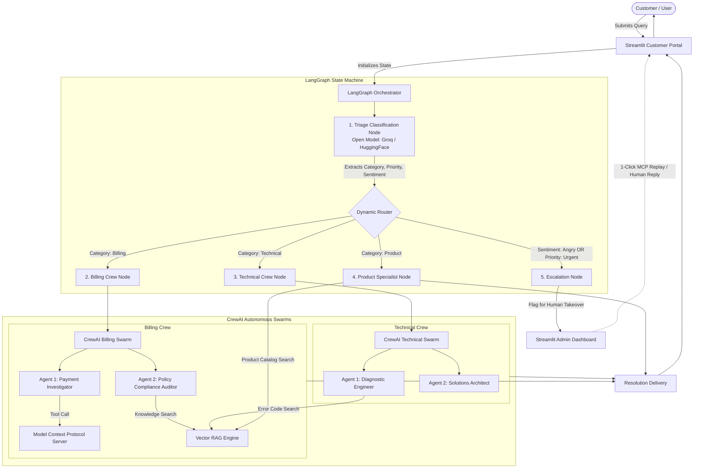

# AI Customer Support Multi-Agent System

An intelligent, enterprise-grade customer support platform integrating **LangGraph**, **CrewAI**, **Google Gemini (Closed Model)**, **Groq/HuggingFace (Open Model)**, **Model Context Protocol (MCP)**, **Vector RAG**, and **Streamlit**.

---

## 🌟 Key Features & Requirements Matrix

| Requirement | Implementation in Project | File / Module |
| :--- | :--- | :--- |
| **1. Pure Python Execution** | 100% Python 3.10+ execution. No external node/npm runtime needed. | All modules (`*.py`) |
| **2. LangGraph (Mandatory)** | Stateful macro-orchestration, DAG routing, state management, and escalation. | [`graph_orchestrator.py`](file:///c:/Users/sowmy/Downloads/day-5/graph_orchestrator.py) |
| **2. CrewAI (Mandatory)** | Autonomous multi-agent swarms (Billing Forensic Crew & Technical Diagnostic Crew). | [`crew_agents.py`](file:///c:/Users/sowmy/Downloads/day-5/crew_agents.py) |
| **3. LangChain / Agno** | Optional; cleanly decoupled so the system runs with zero unnecessary dependencies. | Decoupled |
| **4. Closed Model** | **Google Gemini 2.5 Flash** for deep reasoning, multi-turn synthesis, and policy audit. | [`models.py`](file:///c:/Users/sowmy/Downloads/day-5/models.py) |
| **4. Open Model** | **Groq (Llama-3.3-70B)** / **Hugging Face** for sub-second query & sentiment classification. | [`models.py`](file:///c:/Users/sowmy/Downloads/day-5/models.py) |
| **5. Streamlit** | Interactive UI with **Customer Live Chat** & **Support Operations Admin Control Tower**. | [`app.py`](file:///c:/Users/sowmy/Downloads/day-5/app.py) |
| **6. Model Context Protocol (MCP)** | JSON-RPC 2.0 MCP server exposing live payment records and order replay tools. | [`mcp_server.py`](file:///c:/Users/sowmy/Downloads/day-5/mcp_server.py), [`mcp_client.py`](file:///c:/Users/sowmy/Downloads/day-5/mcp_client.py) |
| **7. RAG Model** | Retrieval-Augmented Generation with document chunking, indexing, and vector similarity. | [`rag_engine.py`](file:///c:/Users/sowmy/Downloads/day-5/rag_engine.py) |

---

## 🏗️ Architecture & Interaction Flow



---

## 📂 Project Structure

```
day-5/
├── app.py                  # Streamlit Dual-Portal (Customer Chat + Support Ops Tower)
├── graph_orchestrator.py   # LangGraph StateGraph (Stateful router & node coordinator)
├── crew_agents.py          # CrewAI Multi-Agent Swarms (Billing & Tech Crews)
├── models.py               # Dual Model Setup (Closed: Gemini, Open: Groq/HuggingFace)
├── mcp_server.py           # Model Context Protocol (MCP) JSON-RPC 2.0 Server
├── mcp_client.py           # MCP Client adapter used by CrewAI agents
├── rag_engine.py           # Vector RAG Engine (Embeddings & Cosine Retrieval)
├── state.py                # Pydantic state and classification schemas
├── requirements.txt        # Python dependencies
└── .env.example            # Environment variables template
```

---

## 🚀 How to Run the Application

### 1. Install Dependencies
```bash
pip install -r requirements.txt
```

### 2. Configure Environment Keys (Optional but Recommended)
Create a `.env` file in the project root:
```env
# Closed Model: Google Gemini API Key
GEMINI_API_KEY="your-google-gemini-api-key"

# Open Model: Groq API Key (or Hugging Face Token)
GROQ_API_KEY="your-groq-api-key"
```
*(Note: If keys are omitted, the platform runs with built-in zero-crash offline demonstration fallbacks).*

### 3. Launch the Streamlit Interface
```bash
streamlit run app.py --server.port=8080 --server.address=0.0.0.0
```

Open your browser to `http://localhost:8080`.

---

## 🧪 Testing the Core Scenarios

1. **Billing Deducted Scenario (Example Prompt):**
   - Click **"💳 Billing Deducted Bug"** or input:
     > *"My payment was deducted, but my order was not confirmed."*
   - **Triage Result:** Category: `BILLING`, Priority: `HIGH`, Sentiment: `Frustrated`.
   - **CrewAI Execution:** Payment Investigator queries MCP server $\to$ finds transaction `tx_992182` status `CHARGED` and order `PENDING`. Policy Auditor references RAG rules $\to$ reassuring message returned.

2. **Technical Incident Scenario:**
   - Click **"🔧 504 Gateway Timeout"** or input:
     > *"Getting error 504 gateway timeout when calling the analytics REST API."*
   - **Triage Result:** Category: `TECHNICAL`, Priority: `HIGH`, Sentiment: `Neutral`.
   - **CrewAI Execution:** Diagnostic Engineer checks RAG technical manual $\to$ Solutions Architect drafts numbered troubleshooting steps.

3. **Urgent Escalation Scenario (Human-in-the-Loop):**
   - Click **"🚨 Urgent Angry Escalation"** or input:
     > *"I was charged twice and nobody responded! Refund my money right now or I am calling legal!"*
   - **Triage Result:** Category: `BILLING`, Priority: `URGENT`, Sentiment: `Angry`, `requires_human: true`.
   - **Router Action:** Routes to `Escalation Agent`.
   - **Admin Tower Action:** Ticket appears in the **Admin Escalation Queue** with 1-click **"⚡ Trigger MCP Replay"** and human override reply tools.
